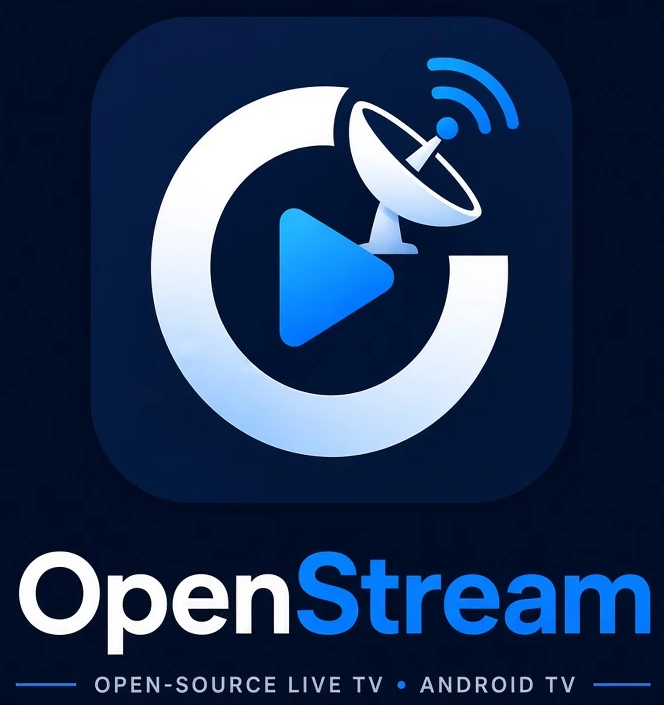

<div dir="rtl">

<p align="center"></p>

# OpenStream

**پخش‌کننده‌ی IPTV برای تلویزیون اندروید، به‌قدری ساده که حتی کسی که هیچ‌وقت سراغ تنظیمات نرفته هم بتواند ازش استفاده کند.**

فارسی · [English](README.md)

OpenStream یک **پخش‌کننده‌ی خالی** است: هیچ شبکه، لیست یا لینکی داخلش نیست. لیست M3U یا اشتراک Xtream Codes خودتان را به آن می‌دهید و اپ آن را مثل یک گیرنده‌ی ماهواره‌ای معمولی نشان می‌دهد: با دکمه‌ی بالا و پایین شبکه عوض می‌شود و با **OK** لیست شبکه‌ها باز می‌شود.

تمام رابط کاربری فارسی و راست‌به‌چپ است و برای دیدن از دور و با یک ریموت ساده طراحی شده: بدون موس، بدون دکمه‌ی ریز و بدون اصطلاح فنی.

## دانلود

آخرین فایل APK را از [صفحه‌ی Releases](https://github.com/amrteimouri/OpenStream/releases/latest) بگیرید (`OpenStream-vX.Y.Z.apk`، حدود ۳ مگابایت). روی هر تلویزیون یا باکس اندرویدی با اندروید ۶ به بالا اجرا می‌شود.

**نصب روی تلویزیون**

- *ساده‌ترین راه:* اپ رایگان **Downloader** را روی تلویزیون نصب کنید، لینک APK را از صفحه‌ی Releases در آن باز کنید و وقتی پرسید «نصب از منبع ناشناس» را اجازه بدهید.
- *یا* APK را با فلش منتقل کنید، یا با `adb install` نصب کنید (پایین‌تر توضیح داده شده).

**بررسی فایل دانلودشده (اختیاری).** هر نسخه مقدار SHA-256 و اثر انگشت گواهی امضا (`07672e0a…3688dc`) را دارد. در ویندوز: `certutil -hashfile OpenStream-vX.Y.Z.apk SHA256`. همه‌ی نسخه‌ها با یک کلید امضا می‌شوند، پس نسخه‌ی جدید روی قبلی نصب می‌شود و لیست‌هایتان می‌ماند.

## امکانات

- **افزودن لیست از روی گوشی، بدون تایپ با ریموت.** تلویزیون یک QR نشان می‌دهد. اسکنش می‌کنید، لینک را در یک صفحه‌ی ساده می‌چسبانید و لیست روی تلویزیون می‌آید.
- **M3U / M3U8 و Xtream Codes.** لینک یا متن لیست را بدهید، یا با آدرس سرور، نام کاربری و رمز Xtream وارد شوید.
- **چند لیست همزمان.** لیست‌ها ادغام می‌شوند (لینک تکراری حذف می‌شود)، هر لیست یک دسته‌ی جدا هم دارد و هر کدام را می‌شود بعداً حذف کرد.
- **پخش HLS و DASH** (با Media3 / ExoPlayer)، همراه با اتصال دوباره‌ی خودکار و پیام‌های خطای ساده‌ی فارسی («لینک این شبکه دیگر وجود ندارد»، «این شبکه با تلویزیون شما سازگار نیست»).
- **قبل از پخش بدانید کدام شبکه کار می‌کند.** شبکه‌ها صفحه‌صفحه نشان داده می‌شوند و با باز شدن هر صفحه، شبکه‌های همان صفحه در پس‌زمینه بررسی می‌شوند: 🟢 سالم، 🔴 خراب، 🟠 در حال بررسی. با دکمه‌ی بالا و پایین، شبکه‌های خراب رد می‌شوند.
- **جستجو** با اسم، روی تلویزیون یا از روی گوشی. مناسب فارسی: «ي» و «ك» عربی با «ی» و «ک» یکی حساب می‌شوند و نیم‌فاصله و اعراب نادیده گرفته می‌شود.
- **علاقه‌مندی‌ها** (نگه داشتن OK روی شبکه) و **دسته‌بندی** از روی لیست.
- **باز شدن روی آخرین شبکه** مثل یک تلویزیون واقعی.
- رفتن به شبکه با **دکمه‌های عددی** ریموت.

## دکمه‌های ریموت

| دکمه | کار |
| --- | --- |
| ▲ / ▼ | شبکه‌ی بعدی / قبلی (شبکه‌های خراب رد می‌شوند) |
| ۰ تا ۹ | رفتن به شماره‌ی شبکه |
| OK | باز کردن لیست شبکه‌ها |
| نگه داشتن OK (در لیست) | افزودن یا حذف علاقه‌مندی |
| ▼ روی آخرین شبکه‌ی صفحه | صفحه‌ی بعد (▲ روی اولین شبکه، صفحه‌ی قبل) |
| برگشت | بستن لیست / برگشتن |

## ساختار

```
 گوشی ── QR / صفحه‌ی وب ──▶ LocalWebServer ──▶ AppViewModel ──▶ playlists/<id>.m3u
                                                    │
                       M3uParser ◀── XtreamClient ──┤
                                                    ▼
                        دسته‌ها · جستجو · علاقه‌مندی‌ها · وضعیت سلامت
                                                    │
                             ┌──────────────────────┴──────────────┐
                        PlayerScreen (ExoPlayer)             ChannelBrowser
                                                          (صفحه‌ها + StreamProbe)
```

| فایل | وظیفه |
| --- | --- |
| `AppViewModel.kt` | وضعیت کل اپ: لیست‌ها، شبکه‌ها، دسته‌ها، علاقه‌مندی‌ها، جستجو و سلامت |
| `LocalWebServer.kt` | وب‌سرور کوچک روی شبکه‌ی خانه برای صفحه‌ی QR و گوشی |
| `M3uParser.kt` | خواننده‌ی خط‌به‌خط M3U که با لیست‌های خیلی بزرگ هم مشکل ندارد |
| `XtreamClient.kt` | ورود به Xtream Codes و تبدیل شبکه‌های زنده به لیست M3U |
| `PlayerScreen.kt` | پلیر تمام‌صفحه، مدیریت دکمه‌ها، نوار اطلاعات و منطق تلاش دوباره |
| `ChannelBrowser.kt` | نوار دسته‌ها، لیست عمودی صفحه‌بندی‌شده و کادر جستجو |
| `Health.kt` | `StreamProbe`: بررسی یک شبکه بدون پخش (لیست ← اولین تکه‌ی ویدیو) |
| `Search.kt` | یکسان‌سازی متن فارسی و جستجو |
| `SetupScreen.kt` و `QrCode.kt` | صفحه‌ی QR و افزودن لیست |

با Kotlin، Jetpack Compose for TV، Media3 (ExoPlayer با HLS و DASH)، Coil و ZXing ساخته شده. پایگاه داده ندارد؛ لیست‌ها فایل ساده در حافظه‌ی خصوصی اپ هستند.

## ساخت و اجرا

پیش‌نیازها: JDK نسخه‌ی ۱۷ به بالا، Android SDK (API 36) و تلویزیون اندروید ۶ یا بالاتر.

```bash
# نسخه‌ی debug
./gradlew assembleDebug

# نسخه‌ی بهینه (روی تلویزیون خیلی سریع‌تر است؛ Compose در حالت debug کند است)
./gradlew assembleRelease
```

فایل APK در `app/build/outputs/apk/` ساخته می‌شود. اگر فایل `keystore.properties` در ریشه‌ی پروژه باشد (داخل گیت نیست)، نسخه‌ی release با آن کلید امضا می‌شود؛ وگرنه با کلید debug امضا می‌شود تا هر کسی بتواند build بگیرد و تست کند. برای امضای نسخه‌ی خودتان، با `keytool` یک keystore بسازید و `storeFile`، `storePassword`، `keyAlias` و `keyPassword` را در `keystore.properties` بنویسید.

### نصب روی تلویزیون با وای‌فای

۱. روی تلویزیون: *Settings ← Device Preferences ← About* را باز کنید، هفت بار روی **Build** بزنید و در *Developer options* گزینه‌ی **USB debugging** را روشن کنید.
۲. روی کامپیوتر (در همان شبکه):

```bash
adb connect <آی‌پی-تلویزیون>:5555
adb install -r app/build/outputs/apk/release/app-release.apk
```

پیام «Allow debugging?» روی تلویزیون را تأیید کنید.

## طرز استفاده

۱. اپ را باز کنید. تلویزیون یک QR و آدرسی مثل `http://192.168.1.20:8080` نشان می‌دهد.
۲. با گوشی‌ای که به همان وای‌فای وصل است QR را اسکن کنید.
۳. لینک لیست (یا اطلاعات Xtream) را بچسبانید و بفرستید. شبکه‌ها روی تلویزیون می‌آیند.
۴. هر وقت خواستید **OK** را بزنید تا شبکه‌ها را ببینید، جستجو کنید یا لیست‌ها را مدیریت کنید («➕ افزودن لیست» در نوار کناری).

## مستندات بیشتر

- [docs/ARCHITECTURE.md](docs/ARCHITECTURE.md): ساختار برنامه و دلیل تصمیم‌ها (وضعیت‌ها، ذخیره‌سازی، بررسی سلامت و مدیریت فوکوس ریموت). این فایل انگلیسی است.
- روی همه‌ی کلاس‌ها و تابع‌های کد، توضیح فارسی (KDoc) نوشته شده است.

## نکته‌ی حقوقی

OpenStream فقط یک پخش‌کننده است. هیچ شبکه یا استریمی را ارائه، میزبانی، فهرست یا پیشنهاد نمی‌کند و مسئولیت داشتن حق تماشای هر چیزی که اضافه می‌کنید با خودتان است. صفحه‌ی «ارسال به تلویزیون» فقط روی شبکه‌ی داخلی خانه‌ی شما در دسترس است و روی اینترنت باز نمی‌شود.

## برنامه‌ی آینده

- راهنمای برنامه‌ها (EPG / XMLTV) با یک خط ساده‌ی «الان / بعدی»
- دسته‌ی «اخیراً دیده‌شده»
- قفل کودک با رمز و حالت «فقط علاقه‌مندی‌ها»
- به‌روزرسانی خودکار دوره‌ای لیست‌ها

## مجوز

MIT، فایل [LICENSE](LICENSE) را ببینید.

</div>
